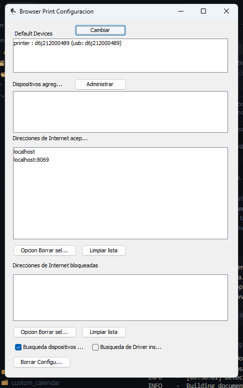
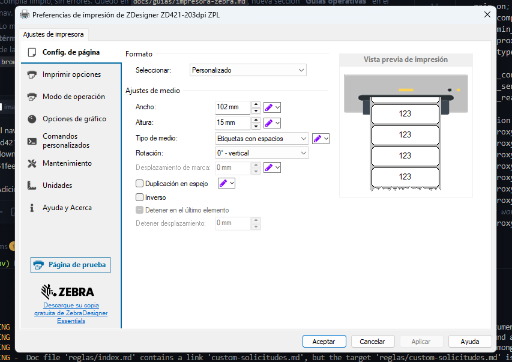
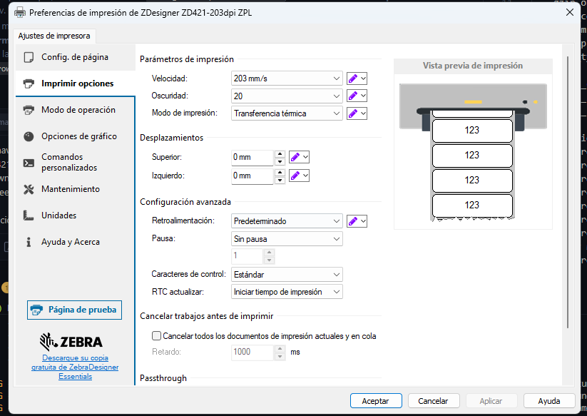
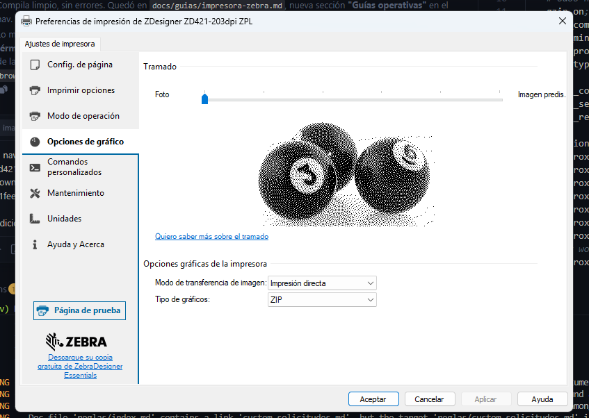

# Configurar la impresora Zebra para etiquetas RC

Guía para dejar un equipo listo para imprimir etiquetas RC (el código único `[L|S|N]#####`) desde Odoo, en Recepción o en Alistamiento. Se hace una sola vez por equipo — no hay que repetirla en cada impresión.

Ver también: [Configurar el lector de código de barras Zebra DS3678](lector-zebra.md).

## Qué hace falta, en resumen

1. La impresora Zebra conectada (USB o red) con su driver instalado.
2. La app **Zebra Browser Print** instalada y corriendo en el equipo.
3. La impresora agregada/visible dentro de esa app.
4. El driver de Windows calibrado al tamaño correcto de rollo.
5. La URL de Odoo agregada a "Direcciones de Internet aceptadas" en Browser Print.

Esto solo aplica al tamaño de etiqueta por defecto (el rollo térmico chico, el que va directo a la Zebra). Si en algún wizard se elige otro tamaño (por ejemplo, el botón **Imp Etiq 17x17** de Recepción), esa impresión sale como PDF normal y se imprime desde cualquier impresora, sin pasar por Browser Print.

## 1. Instalar el driver de la impresora

Para una Zebra ZD421 (el modelo usado en bodega):

- Página del modelo, con todos los drivers/firmware/manuales: [zebra.com — ZD421](https://www.zebra.com/us/en/support-downloads/printers/desktop/zd421.html)
- Artículo de soporte con el paso a paso de instalación del driver: [support.zebra.com — artículo 000027281](https://support.zebra.com/article/000027281)

Windows debe reconocerla como una impresora normal (aparece en "Dispositivos e impresoras", como `ZDesigner ZD421-203dpi ZPL`) antes de seguir.

## 2. Instalar y abrir Zebra Browser Print

Zebra Browser Print es una app aparte de Windows: corre en segundo plano (icono en la bandeja del sistema) y es la que le habla directamente a la impresora — Odoo nunca instala ni reemplaza esto, solo se conecta a ella desde el navegador.

- Formulario de descarga oficial: [zebra.com — Browser Print (PC)](https://www.zebra.com/gb/en/forms/browser-print-request-pc.html)

Confirmar que quede abierta/corriendo, no solo instalada (icono visible en la bandeja del sistema).

## 3. Revisar la configuración de Browser Print

Clic derecho en el icono de Browser Print (bandeja del sistema) → abrir su ventana de configuración:

<figure markdown>

<figcaption>Ventana real de Browser Print — la impresora aparece en "Default Devices" y Odoo ya quedó en "Direcciones de Internet aceptadas".</figcaption>
</figure>

Qué revisar ahí:

- **Default Devices** — debe aparecer la impresora (ej. `printer : d6j212000489 (usb: d6j212000489)`). Si no aparece, revisar el cable/la conexión de red y que el driver del paso 1 haya quedado bien instalado.
- **Direcciones de Internet aceptadas** — debe estar la dirección desde la que se abre Odoo. En un equipo que entra por `http://localhost:8069` deben estar `localhost` y `localhost:8069`, como en la imagen. Si Odoo se abre por otra URL (por ejemplo el dominio real de producción) y no está en esta lista, agregarla a mano ahí — si queda en "Direcciones de Internet bloqueadas" en vez de en la aceptada, Browser Print le va a negar el acceso a esa página aunque la impresora esté bien conectada.
- Dejar tildado **"Busqueda dispositivos..."** para que detecte la impresora automáticamente.

## 4. Calibrar el driver de Windows (ZDesigner)

Desde "Dispositivos e impresoras" → click derecho sobre la impresora → **Preferencias de impresión**. Los 3 valores que importan para que la etiqueta salga bien alineada en el rollo real de 32×15&nbsp;mm (3 columnas, 102&nbsp;mm de ancho total):

**Pestaña "Config. de página":**

<figure markdown>

<figcaption>Formato: Personalizado · Ancho: 102 mm · Altura: 15 mm · Tipo de medio: Etiquetas con espacios · Rotación: 0° - vertical.</figcaption>
</figure>

**Pestaña "Imprimir opciones":**

<figure markdown>

<figcaption>Velocidad: 203 mm/s · Oscuridad: 20 · Modo de impresión: Transferencia térmica · Desplazamientos superior/izquierdo: 0 mm.</figcaption>
</figure>

**Pestaña "Opciones de gráfico":**

<figure markdown>

<figcaption>Modo de transferencia de imagen: Impresión directa · Tipo de gráficos: ZIP.</figcaption>
</figure>

Si la impresora nunca se calibró con este rollo puesto, además correr la calibración de medios física de la impresora (botones del equipo, o "Página de prueba" desde el mismo driver) para que el sensor de gap quede leyendo bien las 3 columnas — si no, puede avanzar una fila completa por cada etiqueta en vez de acomodar las 3 juntas.

## 5. Primer uso desde Odoo

Al presionar por primera vez, desde ese navegador y ese equipo:

- **Imprimir etiquetas** en Alistamiento, o
- **Impr Etiquetas** en Recepción,

el navegador le pide a Browser Print la lista de impresoras. Si la URL de Odoo ya está en "Direcciones de Internet aceptadas" (paso 3), no debería aparecer ningún aviso — imprime directo. Si es la primera vez que esa URL le pide algo a Browser Print, puede aparecer un aviso preguntando si se permite; aceptarlo deja esa dirección guardada en la lista de aceptadas para la próxima vez.

## 6. Verificar que quedó bien

Antes de crear la etiqueta, Odoo ya revisa si hay una Zebra visible — si algo falla en el paso 1-5, avisa con un mensaje ANTES de descontar nada, así que probar no tiene riesgo de "gastar" un código sin haber impreso.

## Solución de problemas

| Mensaje que muestra Odoo | Qué significa | Qué revisar |
|---|---|---|
| "Zebra Browser Print no respondió en este navegador — ¿el agente está corriendo?" | La app Browser Print no está abierta en este equipo (o no está instalada) | Abrir/iniciar Zebra Browser Print (paso 2) y volver a intentar |
| "Browser Print no encontró ninguna impresora conectada." | Browser Print está corriendo pero no ve ninguna impresora agregada | Revisar cable/red, revisar que el driver esté instalado (paso 1), revisar "Default Devices" en la configuración de Browser Print (paso 3) |
| "Error enviando a la Zebra: ..." | Sí encontró la impresora, pero el envío falló | Revisar la impresora físicamente: encendida, con papel, sin atascos, online |
| "No se imprimió: las etiquetas se liberaron. Revisa la impresora y vuelve a Imprimir." | Odoo detectó que no salió papel y deshizo automáticamente el descuento de disponible | No hay que corregir nada en la base de datos — solo arreglar la impresora y repetir "Imprimir" |
| "No salió papel y solo se liberaron N de M etiquetas: el resto quedó descontado. Avisa a sistemas." | Se intentó liberar varias etiquetas a la vez y solo parte de ellas se pudo cancelar (por ejemplo, alguna ya no cumplía el plazo de 10 minutos o el filtro de dueño) | Avisar a sistemas: hay etiquetas que quedaron descontando disponible sin haber impreso, y esas ya no se liberan solas desde el navegador |
| "No salió papel y no se pudieron liberar las etiquetas creadas (...): quedaron descontadas. Avisa a sistemas." | El RPC que libera las etiquetas falló (no solo el envío a la Zebra) | Avisar a sistemas con el detalle del error entre paréntesis: hay que liberar esas etiquetas a mano |

Estos son los mensajes reales que produce el código (`static/src/js/browserprint_utils.js`), no una lista genérica.

Si la impresión sale corrida o solo entra 1 columna por fila en vez de 3, es casi siempre el paso 4 (config. de página del driver) o la calibración física del rollo, no un problema de Odoo ni de Browser Print.
