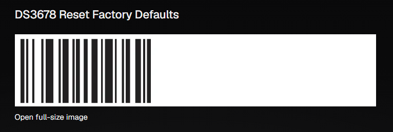
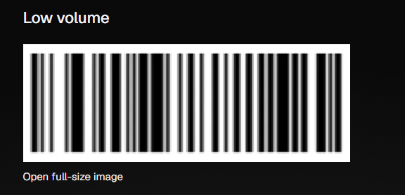
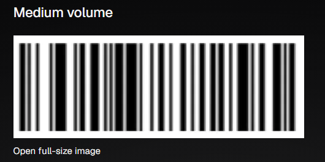
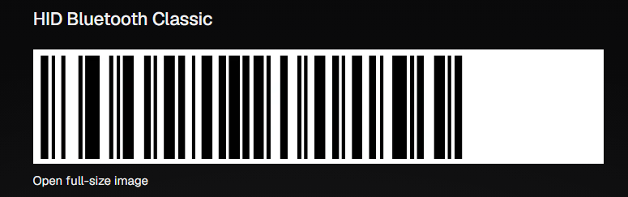
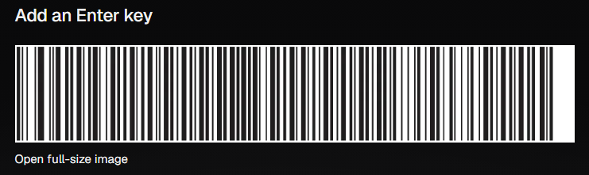

# Configurar el lector de código de barras Zebra DS3678

Guía para dejar un lector Zebra DS3678 listo para escanear etiquetas RC (el código único `[L|S|N]#####`) en Odoo, en Recepción o en Alistamiento. Se hace una sola vez por equipo lector — no hay que repetirla en cada escaneo.

El DS3678 es el modelo **inalámbrico** (se conecta por Bluetooth a una base/cuna, y esa cuna sí va cableada por USB al PC — a diferencia de la impresora, acá no hay una app intermedia tipo Browser Print: una vez bien configurado, el lector funciona como un teclado más). La configuración se hace escaneando códigos de barras especiales impresos en el manual del fabricante — no hay pantalla ni menú en el propio lector.

Todo lo de esta guía está verificado contra el manual oficial (*DS36X8 Digital Scanner Product Reference Guide*, Zebra, Rev. 18EN 07/2024): [PDF completo](https://www.zebra.com/content/dam/support-dam/en/documentation/unrestricted/guide/product/ds36x8-prg-en.pdf). Los links de abajo abren directo en la página exacta del código a escanear (funciona en Chrome/Edge con su visor de PDF integrado).

Orden recomendado: **restaurar → volumen → conexión → tecla Enter.**

## 1. Restaurar a valores de fábrica

Solo hace falta si el lector viene con una configuración previa desconocida, o algo quedó mal configurado y no se sabe qué. Escanear el código **"Set Factory Defaults"** — borra cualquier configuración personalizada y deja todos los parámetros en su valor de fábrica.

<figure markdown>
{ width="320" }
<figcaption>Escanear directo desde la pantalla (sin reflejos) o imprimir a tamaño natural.</figcaption>
</figure>

- [Manual, página 6-5](https://www.zebra.com/content/dam/support-dam/en/documentation/unrestricted/guide/product/ds36x8-prg-en.pdf#page=151)

## 2. Ajustar el volumen del pitido (beeper)

Escanear uno de estos 3 códigos según el volumen deseado — **"Low Volume"**, **"Medium Volume"** o **"High Volume"** (de fábrica viene en High).

<figure markdown>
{ width="280" }
<figcaption>Low Volume</figcaption>
</figure>

<figure markdown>
{ width="280" }
<figcaption>Medium Volume</figcaption>
</figure>

<figure markdown>
{ width="280" }
<figcaption>High Volume (valor de fábrica)</figcaption>
</figure>

- [Manual, página 6-9](https://www.zebra.com/content/dam/support-dam/en/documentation/unrestricted/guide/product/ds36x8-prg-en.pdf#page=155)

## 3. Conexión: lector ↔ cuna por Bluetooth, cuna ↔ PC por USB

Son dos conexiones distintas, cada una con su propia configuración.

### 3a. Bluetooth: el lector con su cuna

1. Conectar el cable USB de la cuna al PC (puerto USB directo, o un hub con alimentación) y su alimentación externa si aplica. Confirmar que las conexiones queden firmes.
2. Elegir el tipo de radio Bluetooth escaneando uno de estos 2 códigos:
    - **Cradle-Classic Bluetooth** — más rápido (hasta 2.1 Mbit/s).
    - **Cradle-Low Energy** — hasta 7 veces más lento (~0.27 Mbit/s), pero convive mejor con redes Wi-Fi 2.4&nbsp;GHz densas (no compite por los mismos canales 1/6/11).

    Para un lector por cuna en bodega, **Classic** es la opción práctica salvo que haya problemas reales de interferencia con el Wi-Fi del sitio.
3. **Emparejar el lector con la cuna**, por cualquiera de las 2 formas (son equivalentes):
    - Colocar el lector en la cuna — si "pair on contacts" está activo (comportamiento de fábrica), empareja solo, sin escanear nada.
    - Escanear el código de barras impreso en la propia cuna (cada cuna trae el suyo, no es un código del manual).
4. Confirmar por el pitido: secuencia alto-bajo-alto-bajo seguida de bajo-alto = emparejó bien. Secuencia larga bajo-largo alto = falló; repetir el paso 3.

- [Manual, tipos de host Bluetooth y códigos Cradle-Classic/Cradle-Low Energy (página 5-5)](https://www.zebra.com/content/dam/support-dam/en/documentation/unrestricted/guide/product/ds36x8-prg-en.pdf#page=88)
- [Manual, pasos generales de conexión y emparejado de la cuna (página 1-5)](https://www.zebra.com/content/dam/support-dam/en/documentation/unrestricted/guide/product/ds36x8-prg-en.pdf#page=40)

### 3b. USB: la cuna con el PC (modo teclado)

1. Escanear el código **"USB HID Keyboard"** (es la opción de fábrica) para que Windows reconozca la cuna como teclado — así el código escaneado entra directo en el campo de texto que tenga el foco en Odoo, igual que si se tipeara.
2. La primera vez, Windows va a mostrar un asistente para instalar el driver de "Dispositivo de interfaz humana" (HID) — darle Siguiente hasta el final y Finalizar. El lector se reinicia solo durante este paso.

- [Manual, pasos de conexión USB (página 8-2)](https://www.zebra.com/content/dam/support-dam/en/documentation/unrestricted/guide/product/ds36x8-prg-en.pdf#page=232)
- [Manual, código "USB HID Keyboard" (página 8-6)](https://www.zebra.com/content/dam/support-dam/en/documentation/unrestricted/guide/product/ds36x8-prg-en.pdf#page=236)

Para probar que quedó como teclado: abrir el Bloc de notas y escanear cualquier código — el texto debe aparecer escrito ahí solo.

### 3c. Alternativa: Bluetooth directo al PC (sin cuna)

Sin pasar por la cuna: el lector se empareja directo con el Bluetooth del PC y funciona como un teclado Bluetooth más. Sirve si el equipo no tiene cuna a mano, o si se prefiere no depender del cable USB de la cuna.

1. Escanear el código **"HID Bluetooth Classic"**. El lector queda visible ("Peripheral mode") para que Windows lo descubra.
2. En Windows: **Configuración → Bluetooth y otros dispositivos → Agregar dispositivo → Bluetooth**, y elegir el lector de la lista.
3. Una vez emparejado, funciona igual que en el modo por cuna: el código escaneado entra directo en el campo de texto que tenga el foco.

<figure markdown>
{ width="320" }
<figcaption>HID Bluetooth Classic</figcaption>
</figure>

- [Manual, Keyboard Emulation (HID) — HID BT Classic (página 5-6)](https://www.zebra.com/content/dam/support-dam/en/documentation/unrestricted/guide/product/ds36x8-prg-en.pdf#page=89)

El tipo de host es un único valor a la vez: escanear "HID Bluetooth Classic" saca al lector del modo "Cradle-Classic Bluetooth" (3a). Si ya estaba emparejado con una cuna y se prueba este modo, para volver a usar la cuna hay que escanear de nuevo "Cradle-Classic Bluetooth" o "Cradle-Low Energy".

## 4. Agregar tecla Enter después de cada escaneo

Esto es lo que hace que, al escanear en un campo de Odoo (por ejemplo Identificación RC), el dato quede confirmado solo sin tener que apretar Enter a mano. Escanear el código **"Add Enter Key (Carriage Return/Line Feed)"**.

<figure markdown>
{ width="320" }
<figcaption>Add Enter Key (Carriage Return/Line Feed)</figcaption>
</figure>

- [Manual, página 6-41](https://www.zebra.com/content/dam/support-dam/en/documentation/unrestricted/guide/product/ds36x8-prg-en.pdf#page=187)

## Notas

- Todos estos códigos se pueden escanear en cualquier momento con el lector encendido — no hace falta tenerlo conectado a Odoo ni a ningún host mientras se configuran.
- Si después de cambiar el tipo de host (Cradle-Classic/Low Energy o USB HID Keyboard, sección 3) el lector queda "trabado" sin responder, Zebra documenta un truco de recuperación: desconectar el cable USB, conectarlo por Bluetooth y volver a escanear "USB HID Keyboard" u otro host (o, en el modelo con cable directo DS3608, desconectar y reconectar el USB sosteniendo el gatillo).
