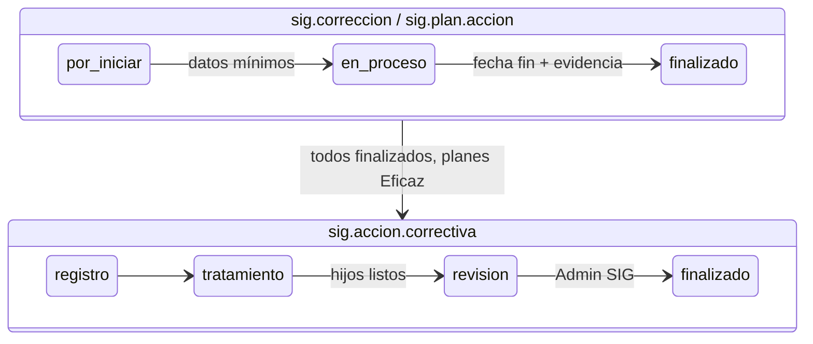

# custom_sig

54 commits de `digital18`, 2026-05-27 → 2026-07-03. Versión del manifest: `17.0.1.0.0`.

!!! note "Alcance de esta página"
    Los 54 commits del módulo son todos de `digital18`; no hay commits de otros autores sobre `custom_sig` en `changes_stock`. La descripción funcional refleja el código actual de la rama. Nada de esta página se verificó en BD ni en navegador: las reglas salen de leer el código y los diffs.

## Visión general

Módulo del Sistema Integrado de Gestión (SIG). Registra no conformidades como **acciones correctivas** (`sig.accion.correctiva`) y las lleva por cuatro fases:

- Registro
- Tratamiento
- Revisión
- Finalizado

Cada acción correctiva tiene dos tipos de línea hija con su propio ciclo de vida: **correcciones** inmediatas (`sig.correccion`) y **planes de acción** (`sig.plan.accion`). Las normas que se pueden citar salen de un catálogo pequeño (`sig.norma`).

Depende solo de `base` y `hr`. Usa `mail.thread` y `mail.activity.mixin` sin declarar `mail` en `depends`: funciona porque `hr` ya depende de `mail`.

Menú **SIG → No Conformidades** (vista kanban agrupada por fase, más lista y formulario) y **SIG → Configuración → Normas / Procedimientos**, este último solo para Administrador SIG.

## Qué problema resuelve

- **Formato de acción correctiva en el sistema.** Reemplaza el formato de no conformidad con los mismos bloques que pide el SIG: hallazgo y evidencia, análisis de causa (problema, 3 porqués, causa raíz), corrección inmediata, plan de acción con evaluación de eficacia, y revisión con doble firma.
- **La fase como contrato.** Una acción correctiva no avanza de fase si la anterior está incompleta. El formulario lo avisa en el momento y el servidor lo vuelve a comprobar (ver [Reglas de negocio](#reglas-de-negocio) para ver dónde no llega esa protección).
- **Cierre controlado.** Solo el Administrador SIG llena el bloque de control de calidad y finaliza la acción correctiva.
- **Visibilidad por área.** Cada usuario ve solo las acciones correctivas de su área (el departamento de su empleado). El administrador ve todas.
- **Guía de diligenciamiento.** Cada sección tiene un enlace "¿No sabes cómo diligenciarlo? Ver un ejemplo" con un caso lleno.

## Arquitectura / componentes principales

Cada flecha de la acción correctiva la valida su `_check_transition_to_<fase>`. "Hijos listos" significa correcciones finalizadas y planes finalizados con eficacia **Eficaz**.

| Capa | Componentes |
|---|---|
| Documento maestro | `models/sig_accion_correctiva.py` (697 líneas): fases, validaciones de transición, consecutivo, área desde el líder, normas |
| Líneas hijas | `models/sig_correccion.py`, `models/sig_plan_accion.py`: estados propios, avance automático por onchange, constraints de fechas y eficacia |
| Catálogo | `models/sig_norma.py` + `data/sig_norma_data.xml` (ISO 9001, ISO 45001, Procedimientos u otros) |
| Seguridad | `security/sig_groups.xml` (4 grupos), `security/ir.model.access.csv`, `security/sig_record_rules.xml` (visibilidad por área) |
| Vistas | `views/sig_accion_correctiva_views.xml` (search, list, kanban, form con statusbar clicable), forms de las líneas hijas, `views/sig_norma_views.xml`, `views/sig_menus.xml` |
| Ayuda contextual | Widget OWL `sig_help_modal`: `static/src/js/help_modal.js`, `help_examples.js`, `static/src/xml/help_modal.xml`; documentación en `docs/widget_help_modal.md` |
| Numeración | `data/ir_sequence_data.xml`: secuencia `sig.accion.correctiva`, prefijo `AC%(y)s-`, 4 dígitos, rango por fecha (p. ej. `AC26-0001`) |
| Tests | `tests/test_revision_transition.py` (3 tests con `odoo.tests.common.Form`) |

El módulo repite un mismo patrón en los tres modelos. Los docstrings lo llaman "tres capas de validación":

1. `@api.onchange('state')`: valida en el formulario vivo (ve las líneas x2many sin guardar). Si falla, lanza `UserError` y el cliente devuelve el statusbar o el dropdown a la fase anterior.
2. `write()`: guardia antes de guardar, para requisitos que son campos del propio registro.
3. `@api.constrains`: guardia después de guardar, para lo que depende de líneas hijas ya persistidas (la transición a Revisión) y para invariantes de fechas y eficacia.

## Procesos funcionales

### Registro

1. El usuario crea la acción correctiva y elige el **Líder de Área** (`hr.employee`). El área (`hr.department`) se llena sola desde el departamento del empleado (`_onchange_lider_area_id`). En servidor, `create()` y `write()` la vuelven a resolver con `_resolve_area_for_lider`, para que una carga por API o importación no quede con `area_id` vacío.
2. Llena fecha de detección (por defecto hoy), fuente (Auditoría Interna/Externa, Proceso Interno, INREDI, PESV, PQR, Otro), si ha ocurrido antes, normas y hallazgo.
3. Según lo elegido aparecen campos condicionales:
    - una norma ISO muestra **Numeral**;
    - "Procedimientos u otros" muestra **¿Cuál?**;
    - una fuente de auditoría o PESV muestra **Evidencia**;
    - "¿Ha ocurrido antes? = Sí" muestra **NC Anterior**, que es opcional desde `7df0bbe94`.
4. No se pueden mezclar normas ISO con otras. El onchange limpia la selección y avisa, y un `@api.constrains` bloquea en servidor.
5. El consecutivo se asigna cuando al menos 4 campos de `_REGISTRO_FIELDS` tienen valor. Como líder, área, fecha y fuente son `required`, en la práctica el consecutivo sale en el primer guardado.
6. Pasar a **Tratamiento** exige líder, área, fecha, fuente, incidencia, hallazgo y al menos una norma, más los condicionales del paso 3 (salvo NC Anterior).

### Tratamiento

Se abren dos pestañas, editables solo en esta fase:

- **Corrección y Análisis**: lista de correcciones y el análisis de causa: Problema, 1, 2 y 3 Por qué, Causa Raíz. El modelo tiene **tres** porqués, no cinco (ver [Bugs y decisiones](#bugs-y-decisiones-relevantes)).
- **Plan de Acción y Recursos**: lista de planes y casillas de recursos (Talento Humano, Tecnológico, Equipos de Cómputo, Papelería, Otros + ¿Cuál?).

Pasar a **Revisión** (`_check_transition_to_revision`) exige:

- los cinco campos del análisis de causa;
- al menos un recurso, y "¿Cuál?" si se marcó Otros;
- al menos una corrección, y todas en `finalizado`;
- al menos un plan, y todos en `finalizado` **y** con eficacia `eficaz`.

Si falta algo, sale un solo mensaje con secciones (Tratamiento / Corrección / Plan de acción) que lista todo lo pendiente (`defc8d1e5`).

### Correcciones y planes de acción (líneas hijas)

Ambos modelos van por `por_iniciar → en_proceso → finalizado`. El estado es un dropdown dentro del formulario de la línea (`7a225e466` quitó su statusbar) y **avanza solo** a medida que se llenan campos (`_onchange_compute_state`):

| Paso | Corrección | Plan de acción |
|---|---|---|
| → En Proceso | Acción, Fecha Inicio, Responsable | Acción a Realizar, Responsable, Fecha Inicio |
| → Finalizado | lo anterior + Fecha Fin + Evidencia / Soporte | lo anterior + Fecha Final + Eficacia (Eficaz o No Eficaz) + Evaluación de Eficacia |

Reglas de fecha (desde `defc8d1e5`):

- con fecha de inicio futura, la línea se queda en Por Iniciar;
- con fecha fin futura, no puede quedar Finalizado;
- la fecha fin no puede ser anterior a la de inicio.

En un plan, bajar la eficacia a Por Verificar sobre un plan finalizado lo devuelve a En Proceso (onchange y `write()`, `b15afefb8`).

Un plan **No Eficaz** puede quedar Finalizado, pero bloquea el paso de la acción correctiva a Revisión. El código no ofrece otra salida que cambiar esa eficacia o agregar otro plan. Sin evidencia de cuál es el flujo esperado con el área SIG, queda en [Pendientes](#pendientes-puntos-por-confirmar).

### Revisión y cierre

La pestaña Revisión (visible en Revisión y Finalizado) tiene dos columnas:

- **Control de calidad**: Revisión SIG, Revisó, Fecha de Revisión (no futura), Observación, Firma de Control de Calidad. Editable solo si `es_admin_sig` (grupo Administrador SIG, recomputado por usuario con `depends_context('uid')`).
- **Firma del Área**: Líder de Área (solo lectura), Observación del Área, Firma del Líder. La puede llenar cualquier usuario con escritura.

Finalizar exige Revisión SIG, Revisó, Fecha de Revisión, Firma de Control de Calidad y Firma del Líder. Las observaciones son opcionales. Además, `write()` exige el grupo Administrador SIG (`AccessError` si no). En Finalizado aparece una pestaña de resumen de solo lectura con todo el expediente (`68493fb45`).

### Catálogo de normas

`sig.norma` es una tabla `name` + `code`. Trae tres registros por data XML (`noupdate="1"`): `iso_9001`, `iso_45001`, `procedimientos`. El Administrador SIG la edita desde Configuración (tree editable); los demás grupos solo la leen. El `code` es la llave de las validaciones, pero no todas las validaciones lo usan de la misma forma (ver [Bugs y decisiones](#bugs-y-decisiones-relevantes)).

## Evolución del módulo

### 1. Fundación del módulo (27-may → 29-may-2026)

Scaffold estándar y, dos días después, en un solo día, los tres modelos, vistas, menús, seguridad, secuencia, cron y un documento de desarrollo. El cron y el documento se retiraron después (capítulo 6).

??? abstract "Commits y archivos del capítulo (6 commits)"

    | Commit | Fecha | Qué hizo |
    |---|---|---|
    | `b7243624f` | 2026-05-27 | Scaffold del módulo. |
    | `f478b1bd2` | 2026-05-29 | Modelos de acción correctiva, corrección y plan de acción. |
    | `3f6c5a6f5` | 2026-05-29 | Vistas y menús de los tres modelos. |
    | `33e42fff4` | 2026-05-29 | Seguridad, permisos, secuencia y cron iniciales. |
    | `545a07ecb` | 2026-05-29 | `DESARROLLO.md` y `docs/statusbar_clickable_behavior.md` (borrados en `430616e13`). |
    | `670c581f7` | 2026-05-29 | Quita archivos genéricos del scaffold. |

    **Archivos:** `__init__.py`, `__manifest__.py`, `models/sig_accion_correctiva.py`, `models/sig_correccion.py`, `models/sig_plan_accion.py`, `views/sig_*_views.xml`, `views/sig_menus.xml`, `security/groups.xml`, `security/ir.model.access.csv`, `data/ir_cron_data.xml`, `data/ir_sequence_data.xml`

### 2. Formularios de fase y máquina de estados (01-jun → 04-jun)

El bloque más denso: 18 commits en cuatro días. Se armaron los formularios de las líneas hijas y el patrón onchange + `write()` + constraint. En las líneas hijas se cambió el statusbar por un dropdown con avance automático. Se corrigieron pérdidas de datos al cambiar de fase y un desfase UI/BD. Se probó hacer obligatorios los campos por fase en la vista y se revirtió el mismo día.

??? abstract "Commits y archivos del capítulo (18 commits)"

    | Commit | Fecha | Qué hizo |
    |---|---|---|
    | `ffb7a325d` | 2026-06-01 | Formulario de `sig.correccion`. |
    | `334cf08da` | 2026-06-01 | Validaciones de transición y constraint de `fecha_deteccion`. |
    | `8286b3341` | 2026-06-01 | Actualiza el documento del statusbar clicable. |
    | `911280214` | 2026-06-01 | Formulario de `sig.plan.accion`. |
    | `60eabb07f` | 2026-06-02 | Validaciones de transición y mejoras de vista en corrección. |
    | `9875a1629` | 2026-06-02 | Validaciones de transición y mejoras de vista en plan de acción. |
    | `00fca8a7d` | 2026-06-02 | Corrige la validación de paso a Revisión; alinea colores del kanban. |
    | `7a225e466` | 2026-06-02 | Líneas hijas: dropdown de estado en vez de statusbar, y avance automático. |
    | `506ee1c9d` | 2026-06-02 | Corrige pérdida de campos y errores fantasma al cambiar de fase. |
    | `909f753b7` | 2026-06-03 | Evita perder líneas hijas al cambiar de fase; endurece validaciones. |
    | `69da4abe2` | 2026-06-03 | Revisión en dos columnas; exige campos para finalizar. |
    | `a12050ca2` | 2026-06-03 | Bug: desfase UI/BD al pasar a Revisión; el onchange valida hijos (+ test). |
    | `68493fb45` | 2026-06-04 | Resumen de solo lectura en la fase Finalizado. |
    | `6a676743d` | 2026-06-04 | Permite fechas pasadas y futuras (para migrar acciones de años anteriores). |
    | `2074f108e` | 2026-06-04 | Reorganiza el formulario de corrección. |
    | `29ffbaf39` | 2026-06-04 | El notebook abre en la fase actual. |
    | `6b57dd387` | 2026-06-04 | Exige campos obligatorios por fase en la vista. |
    | `1760479f4` | 2026-06-04 | Revierte `6b57dd387` el mismo día. |

    **Archivos:** `models/sig_accion_correctiva.py`, `models/sig_correccion.py`, `models/sig_plan_accion.py`, `views/sig_accion_correctiva_views.xml`, `views/sig_correccion_views.xml`, `views/sig_plan_accion_views.xml`, `tests/test_revision_transition.py`

??? warning "Bug corregido — desfase UI/BD al pasar a Revisión (`a12050ca2`)"
    El onchange de `state` no revisaba las líneas hijas; ese chequeo solo existía en el `@api.constrains`, que corre después de guardar. La UI mostraba Revisión mientras la BD seguía en Tratamiento. Ahora el onchange llama `_check_transition_to_revision(check_children=True)` y el statusbar vuelve atrás. El mismo commit agregó `tests/test_revision_transition.py` (3 tests) y volvió obligatoria la Firma de Control de Calidad para finalizar.

??? note "Experimento revertido — obligatorios por fase (`6b57dd387` → `1760479f4`)"
    `required` en la vista impedía guardar borradores en cada fase. El revert delega la exigencia en los validadores `_check_transition_*`. Su mensaje dice que el experimento "queda registrado en `3fc1c1d46`", pero ese hash no existe en el repositorio (la historia se reescribió). El experimento sí está en `6b57dd387`.

### 3. Seguridad, permisos y visibilidad por área (05-jun → 26-jun)

??? abstract "Commits y archivos del capítulo (4 commits)"

    | Commit | Fecha | Qué hizo |
    |---|---|---|
    | `fb6f28377` | 2026-06-05 | Renombra grupos; agrega roles "sin creación ni eliminación" y "solo lectura". |
    | `09d262411` | 2026-06-09 | Quita `noupdate="1"` de `sig_groups.xml`. |
    | `fe92f175e` | 2026-06-10 | Control de calidad editable solo por Administrador SIG (`es_admin_sig`); notas de firma en el chatter con el autor real. |
    | `88d568866` | 2026-06-26 | Record rules: cada usuario ve solo las AC de su área. |

    **Archivos:** `security/sig_groups.xml` (antes `security/groups.xml`), `security/ir.model.access.csv`, `security/sig_record_rules.xml` (nuevo), `models/sig_accion_correctiva.py`, `views/sig_accion_correctiva_views.xml`, `views/sig_menus.xml`

La auditoría de firmas de `fe92f175e` ya no existe: `3a0cda4aa` (capítulo 4) borró esas notas del chatter.

Sin `noupdate`, cada upgrade reescribe los grupos y vuelve a meter a `base.user_admin` en Administrador SIG.

### 4. Tracking en el chatter — implementación, cobertura y rollback (05-jun → 17-jun)

??? abstract "Commits y archivos del capítulo (4 commits)"

    | Commit | Fecha | Qué hizo |
    |---|---|---|
    | `8810d8660` | 2026-06-05 | `tracking=True` en campos de los tres modelos. |
    | `e35f14bf9` | 2026-06-09 | Propaga el tracking de las líneas hijas al chatter del padre. |
    | `82c207cb5` | 2026-06-10 | Test de la propagación (`tests/test_child_tracking.py`). |
    | `3a0cda4aa` | 2026-06-17 | Solo `state` queda con tracking; borra la propagación, las notas de firma y el test (−662 líneas netas). |

    **Archivos:** `models/sig_accion_correctiva.py`, `models/sig_correccion.py`, `models/sig_plan_accion.py`, `tests/test_child_tracking.py` (agregado y luego eliminado)

??? warning "Riesgo — funcionalidad probada borrada sin causa de producto (`3a0cda4aa`)"
    Una semana después de agregar la propagación con su test dedicado (249 líneas), `3a0cda4aa` la retiró junto con el test. El mensaje dice qué se quitó y califica la propagación de "código muerto sin referencias" y el test de "obsoleto", pero no dice por qué se decidió que el chatter registrara solo fases (¿ruido?, ¿rendimiento?, ¿pedido del área?). Hoy el chatter no registra cambios de datos, firmas ni cambios en líneas hijas: solo transiciones de fase.

Es el mismo patrón que en [custom_barcode_activos](custom_barcode_activos.md) (capítulo 3, `6b26f79fa`): el autor agrega una funcionalidad con tests y días o semanas después cambia de enfoque y borra esos tests.

### 5. Widget de ayuda (05-jun → 03-jul)

??? abstract "Commits y archivos del capítulo (5 commits)"

    | Commit | Fecha | Qué hizo |
    |---|---|---|
    | `a9d5e590f` | 2026-06-05 | Widget `sig_help_modal` con ejemplos por fase. |
    | `1f043ee4a` | 2026-06-09 | Rediseño con Bootstrap 5. |
    | `68097d4b2` | 2026-06-11 | Color de labels en el modal. |
    | `a38311b0e` | 2026-06-17 | Ejemplos para corrección y plan de acción. |
    | `a3c0b8ed1` | 2026-07-03 | Mueve `widget_help_modal.md` a `custom_sig/docs/`. |

    **Archivos:** `static/src/js/help_examples.js`, `static/src/js/help_modal.js`, `static/src/xml/help_modal.xml`, `views/sig_accion_correctiva_views.xml`, `views/sig_correccion_views.xml`, `views/sig_plan_accion_views.xml`, `docs/widget_help_modal.md`

`a3c0b8ed1` es un commit de cierre de PR que también toca `.gitignore`, `Modelfile` y `custom_empleados/security/empleados_groups.xml`. Solo el movimiento del documento pertenece a `custom_sig`.

### 6. Ajustes finos, catálogo de normas y limpieza técnica (05-jun → 23-jun)

La norma pasó de Selection a Many2many con catálogo propio. El formulario se reordenó varias veces. Se quitaron cron, correos y código muerto. `defc8d1e5` es más grande de lo que dice su título (ver callout).

??? abstract "Commits y archivos del capítulo (17 commits)"

    | Commit | Fecha | Qué hizo |
    |---|---|---|
    | `e1a94d6a8` | 2026-06-05 | Campos del grupo Registro en dos columnas. |
    | `430616e13` | 2026-06-05 | Borra `DESARROLLO.md` y `docs/statusbar_clickable_behavior.md`. |
    | `6f531dde3` | 2026-06-09 | Norma: de Selection a Many2many con catálogo `sig.norma` (modelo nuevo). |
    | `02cab6d9b` | 2026-06-09 | Notebook en el orden natural de fases. |
    | `87ed0e185` | 2026-06-10 | `no_open` en many2one para no abrir el registro. |
    | `f56d73e82` | 2026-06-10 | Aplana el notebook y fija `readonly` por campo. |
    | `cd7741e11` | 2026-06-10 | Menú y vistas para gestionar `sig.norma`. |
    | `707d434a3` | 2026-06-11 | Ortografía y tildes en labels y mensajes. |
    | `36b386471` | 2026-06-11 | Ícono del módulo en el app switcher. |
    | `ef2f567b7` | 2026-06-11 | Quita cron jobs y correos (−76 líneas, `data/ir_cron_data.xml` fuera). |
    | `2a51c1798` | 2026-06-11 | Docstrings estilo Sphinx. |
    | `45d7a7390` | 2026-06-11 | Quita `controllers/` vacío, imports sin uso y markup comentado. |
    | `7df0bbe94` | 2026-06-16 | NC Anterior deja de ser obligatoria cuando "¿Ha ocurrido antes?" es Sí. |
    | `b15afefb8` | 2026-06-16 | Coherencia de eficacia: bajar a Por Verificar revierte el plan; exige Evaluación de Eficacia. |
    | `31db3aa4f` | 2026-06-16 | Correcciones arriba, análisis abajo; muestra todos los campos del análisis a la vez. |
    | `defc8d1e5` | 2026-06-23 | Alerta única de paso a Revisión, reglas de fecha en líneas hijas y más (ver callout). |
    | `11f72cad8` | 2026-06-23 | Quita el correo al encargado SIG por la firma del líder. |

    **Archivos:** `models/sig_norma.py` (nuevo), `data/sig_norma_data.xml`, `views/sig_norma_views.xml`, `models/sig_accion_correctiva.py`, `models/sig_correccion.py`, `models/sig_plan_accion.py`, `static/src/js/help_examples.js`, `views/*.xml`, `data/ir_cron_data.xml` (removido), `controllers/__init__.py` (removido)

??? warning "`defc8d1e5` cambia reglas de negocio bajo un título de UX"
    El título habla de consolidar alertas, pero el commit suma +440 líneas en 7 archivos. El cuerpo lista: plan de acción exige **Eficaz** (no solo finalizado) para pasar a Revisión; reglas de fecha futura y de rango en correcciones y planes; kanban agrupado por fase; filtro por área por defecto; `_rec_name` de corrección. Además agrega sin mencionarlo `_check_fecha_revision_no_futura` y el correo `_notificar_firma_lider_a_sig`. Las reglas de fecha futura reintroducen en parte lo que `6a676743d` había quitado; las fechas pasadas siguen permitidas, así que la migración de años anteriores no se bloquea.

??? note "Correo de firma del líder: cómo recuperarlo"
    `11f72cad8` dice que la funcionalidad "queda intacta en el commit padre `ea845d1fb`". Ese hash no existe en el repositorio. El código está en `defc8d1e5`, el mismo día; para reintroducirlo hay que revertir `11f72cad8`.

## Modelos principales

| Modelo | Representa | Campos clave |
|---|---|---|
| `sig.accion.correctiva` | No conformidad y su tratamiento completo. `mail.thread` + `mail.activity.mixin`; `_rec_name = consecutivo` | `consecutivo`, `state`, `lider_area_id`, `area_id`, `fecha_deteccion`, `fuente`, `incidencia`, `nc_anterior_id`, `norma_ids`, `norma_cual`, `numeral`, `hallazgo`, `evidencia`, `problema`, `por_que_1..3`, `causa_raiz`, `recurso_*`, `correccion_ids`, `plan_accion_ids`, `revision_sig`, `reviso_ids`, `fecha_revision`, `observacion_revision`, `firma_sig`, `firma_lider`, `observacion_area` |
| `sig.correccion` | Corrección inmediata. `_rec_name = accion`; sin chatter | `accion_correctiva_id` (cascade), `accion`, `responsable_id`, `fecha_inicio`, `fecha_fin`, `evidencia_soporte`, `state` |
| `sig.plan.accion` | Plan de acción con evaluación de eficacia; sin chatter | `accion_correctiva_id` (cascade), `accion_realizar`, `responsable_id`, `fecha_inicio`, `fecha_final`, `state`, `eficacia`, `evaluacion_eficacia` |
| `sig.norma` | Catálogo de normas / documentos internos | `name`, `code` (sin restricción de unicidad) |

Campos calculados auxiliares de vista (no stored) en `sig.accion.correctiva`: `norma_es_iso`, `norma_es_procedimiento` (muestran Numeral o ¿Cuál?) y `es_admin_sig` (readonly del control de calidad).

`hr.employee` y `hr.department` se usan sin extenderlos.

## Wizards / vistas / JS relevantes

**Wizards:** ninguno.

**Vistas**

| Vista | Detalle |
|---|---|
| Kanban de acción correctiva | Agrupada por `state`, sin crear ni borrar columnas; borde de color por fase. Es la vista por defecto de la acción, con `search_default_group_area`. |
| Formulario de acción correctiva | Statusbar **clicable** en el header. Campos de Registro `readonly="state != 'registro'"` con `force_save`. Pestañas: Corrección y Análisis, Plan de Acción y Recursos (desde Tratamiento), Revisión (Revisión/Finalizado), Finalizado (resumen). Chatter. |
| Formularios de corrección y plan | Se abren desde el one2many (`form_view_ref`). Período con widget `daterange` sobre `fecha_inicio`/`fecha_fin(al)`; estado como `selection`. |
| Normas | Tree editable + form, solo bajo Configuración. |

**JS / OWL**

| Archivo | Rol |
|---|---|
| `help_modal.js` | Widget de vista `sig_help_modal` (`<widget name="sig_help_modal" example="..."/>`). Abre un `Dialog` que busca el contenido por `key` en el registry `sig_help_examples` y el layout por `kind` en `sig_help_renderers` (`fields`, `cards`, `five_whys`; cae a `fields` si el kind no existe). |
| `help_examples.js` | Contenido de los ejemplos: `registro`, `tratamiento` (kind `five_whys`, 3 porqués), `correccion`, `plan_accion`. |
| `help_modal.xml` | Enlace, cascarón del modal y los tres layouts QWeb. |

El layout `cards` está registrado pero ninguna entrada lo usa hoy. Los registries son abiertos: otro módulo puede agregar ejemplos o layouts sin tocar el widget (`docs/widget_help_modal.md`).

## Reglas de negocio

Validaciones que hoy existen en servidor:

| Regla | Dónde | Efecto |
|---|---|---|
| Área resuelta en servidor | `_resolve_area_for_lider` en `create`/`write` | Área manual > departamento del líder > `UserError`. |
| Fecha de detección fija | `write()` | `UserError` si se edita fuera de Registro. |
| Normas no mezcladas | `_check_norma_no_mezcladas` (`@api.constrains`) | Rechaza mezclar códigos `iso_*` con códigos no `iso_*`. |
| Registro → Tratamiento | `write()` + onchange → `_check_transition_to_tratamiento` | Campos de Registro y condicionales (Numeral, ¿Cuál?, Evidencia). |
| Tratamiento → Revisión | `_check_state_constraints` (`@api.constrains('state')`) + onchange | Análisis de causa, recursos, correcciones finalizadas, planes finalizados y Eficaz. Corre cada vez que `state` queda en `revision`, venga de donde venga. |
| Revisión → Finalizado | `write()` + onchange → `_check_transition_to_finalizado` | Revisión SIG, Revisó, Fecha, Firma SIG, Firma Líder; en `write()` también el grupo Administrador SIG. |
| Fecha de revisión no futura | `_check_fecha_revision_no_futura` + onchange | `UserError`; el onchange limpia el campo. |
| Líneas: Por Iniciar → En Proceso | `write()` + onchange | Campos mínimos; fecha de inicio no futura. |
| Líneas: En Proceso → Finalizado | `write()` + onchange | Fecha fin y evidencia (corrección) o eficacia + evaluación (plan); fecha fin no futura. |
| Rango de fechas | `_check_fechas_coherentes` en ambas líneas | Fin no anterior a inicio. |
| Iniciada sin inicio futuro / finalizada sin fin futuro | constraints `_check_inicio_no_futuro_*`, `_check_fin_no_futuro_*` | Cubre editar la fecha sin tocar el estado. |
| Plan finalizado con eficacia definida | `_check_eficacia_definida_si_finalizado` | Rechaza `finalizado` + `por_verificar`. |

Permisos:

| Grupo | Acción correctiva / corrección / plan | Normas |
|---|---|---|
| Administrador SIG (`group_custom_sig_manager`, implica Usuario) | CRUD completo; ve todas las áreas | CRUD |
| Usuario SIG (`group_custom_sig_user`) | Leer, escribir, crear; no borrar | Leer |
| Usuario SIG sin creación ni eliminación | Leer, escribir | Leer |
| Usuario SIG solo lectura | Leer | Leer |

Record rules (`88d568866`): los tres grupos no administradores ven solo registros con `area_id = user.employee_id.department_id` (en líneas hijas, vía `accion_correctiva_id.area_id`). Un usuario sin empleado o sin departamento no ve ninguna acción correctiva. Las reglas no fijan `perm_*`, así que también aplican a crear y escribir.

Efectos automáticos:

- Consecutivo `AC<aa>-NNNN` al tener 4 campos de Registro con valor.
- Área desde el líder (onchange y servidor).
- Estado de las líneas hijas avanza y retrocede solo según los campos llenos (onchange).
- Plan finalizado vuelve a En Proceso si la eficacia baja a Por Verificar (`write()`).
- Chatter: solo cambios de `state` de la acción correctiva.

## Bugs y decisiones relevantes

**Corregidos en el periodo**

| Tema | Causa raíz | Commit |
|---|---|---|
| Pérdida de campos y errores fantasma al cambiar de fase | No documentada en detalle en el mensaje. | `506ee1c9d` |
| Pérdida de líneas hijas al cambiar de fase | No documentada en detalle en el mensaje; la vista actual usa `force_save` en los one2many. | `909f753b7` |
| UI en Revisión con BD en Tratamiento | El onchange no validaba hijos; solo lo hacía el constraint post-flush. | `a12050ca2` |
| `options` del `daterange` inválido | `'always_range': true` (bareword JS) no lo acepta `ast.literal_eval`; pasó a `True`. | `a12050ca2` |
| Planes finalizados sin evaluar llegaban a Revisión | Bajar la eficacia no revertía el estado. | `b15afefb8` |
| Área vacía en cargas por API | Un `required` que solo llena un onchange falla con NOT NULL fuera de la UI. | `_resolve_area_for_lider` (docstring) |

**Decisiones**

- **Statusbar clicable en la acción correctiva, dropdown en las líneas** (`7a225e466`): en las líneas el estado se guarda con el formulario y avanza solo.
- **Sin `required` por fase en la vista** (`1760479f4`): los borradores deben poder guardarse; la exigencia vive en `_check_transition_*`.
- **Fechas pasadas permitidas** (`6a676743d`): para migrar acciones correctivas de años anteriores.
- **Chatter solo de fases** (`3a0cda4aa`): sin causa de producto escrita (ver capítulo 4).
- **Sin cron ni correos** (`ef2f567b7`, `11f72cad8`): el correo de firma del líder se quitó "a pedido", para reintroducirlo más adelante.
- **NC Anterior opcional** (`7df0bbe94`): si queda vacía, el placeholder pide registrar el motivo en la observación de Revisión.

**Abiertos, verificados contra el código actual**

!!! warning "Las transiciones solo se validan hacia adelante y de a una fase"
    `write()` valida únicamente `registro → tratamiento` y `revision → finalizado`; el constraint, solo que el estado final sea `revision`. No hay guardia para:

    - **Retroceder.** Cualquier usuario con escritura (incluido "sin creación ni eliminación") puede hacer clic en Registro o Tratamiento en el statusbar de una acción **finalizada**. Ni el onchange ni `write()` lo impiden, y los campos vuelven a ser editables.
    - **Saltar fases.** `tratamiento → finalizado` no pasa por el chequeo de grupo de `write()`. Se puede llegar desde la UI: una acción que ya estuvo en Revisión con las firmas llenas se devuelve a Tratamiento y luego se hace clic en Finalizado. El onchange (`check_access=False`) pasa porque las firmas siguen ahí, y `write()` no revisa ese par de estados. Por API, `registro → finalizado` tampoco se valida.
    - **Crear en una fase avanzada.** `create()` no valida `state`: por API se puede crear una acción correctiva o una línea hija ya `finalizado`.

    El documento de diseño borrado en `430616e13` (`statusbar_clickable_behavior.md`) afirmaba "Es imposible saltarse la validación". Nunca fue cierto para estos caminos. Es el caso que describe la regla del repositorio sobre invariantes (statusbar clicable → proteger en servidor).

!!! warning "Control de calidad restringido solo en la vista"
    `revision_sig`, `reviso_ids`, `fecha_revision`, `observacion_revision` y `firma_sig` son readonly para no administradores solo por `es_admin_sig` en el XML. `write()` no los protege: un Usuario SIG puede escribirlos por RPC. El mismo documento de diseño pedía "restricciones de grupos dentro de los validadores, no en la UI". Solo finalizar está protegido en servidor, y solo desde Revisión (ver callout anterior).

??? warning "Test probablemente roto desde `b15afefb8`"
    `test_revision_transition.py` no se tocó después de `707d434a3` (2026-06-11). Su helper `_add_plan_finalizado` pone `eficacia = "eficaz"` sin `evaluacion_eficacia`. Desde `b15afefb8`, `_onchange_compute_state` pasa el plan a `finalizado`. En Odoo 17 el onchange encadena los campos que modifica (`web/models/models.py`, bucle `while todo`), así que después corre `_onchange_state`, y ese `_check_transition_to_finalizado` exige la evaluación y lanza `UserError`. Si es así, 2 de los 3 tests fallan. **No se ejecutó** (correrlo requiere actualizar el módulo). El mismo encadenamiento significa que, en la UI, elegir Eficaz antes de escribir la evaluación (con fecha final ya cumplida) lanza error.

??? warning "Líder sin departamento: la vista no deja elegir el área"
    `_onchange_lider_area_id` vacía el área y dice "Seleccione el Área manualmente". Pero `area_id` tiene `readonly="1"` en el formulario desde `909f753b7`, y es `required`: con un líder sin departamento no se puede guardar desde la UI. Por API sí se puede pasar `area_id` explícito.

- **Detección de ISO inconsistente entre vista y validación.** `norma_es_iso`/`norma_es_procedimiento` buscan el texto "ISO"/"PROCEDIMIENTOS" en `name` y `code`. `_check_transition_to_tratamiento` exige Numeral solo para los códigos exactos `iso_9001`/`iso_45001` y ¿Cuál? solo para `procedimientos`. `_check_norma_no_mezcladas` usa `code.startswith("iso_")`. Una norma nueva creada desde Configuración (p. ej. código `iso_14001`, o un nombre con "ISO" y otro código) muestra Numeral sin exigirlo, o se mezcla distinto. Hay tres líneas comentadas con la versión por código en `_compute_norma_tipo`.
- **`sig.norma.code` sin unicidad.** Es la llave de las validaciones y el tree de Configuración es editable.
- **Rama del consecutivo en `write()` casi inalcanzable.** Como los 4 campos que cuentan para el umbral son `required`, `create()` siempre asigna el consecutivo. La rama de `write()` solo aplica a registros previos a esos `required`.
- **Record rules también restringen crear.** Un Usuario SIG no puede crear ni guardar una acción correctiva cuyo líder sea de otra área: la regla falla al escribir. Puede ser lo buscado; no hay evidencia escrita.
- **`nc_anterior_id` sin dominio.** Se puede elegir la propia acción correctiva como NC Anterior.

## Historial de commits

??? note "Ver los 54 commits en orden"

    | # | Commit | Fecha | Mensaje |
    |---|---|---|---|
    | 1 | `b7243624f` | 2026-05-27 | Inicio módulo custom_sig |
    | 2 | `f478b1bd2` | 2026-05-29 | Crear modelos de acciones correctivas, correcciones y planes de acción |
    | 3 | `3f6c5a6f5` | 2026-05-29 | Crear vistas y menús para los modelos del sistema |
    | 4 | `33e42fff4` | 2026-05-29 | Configurar seguridad, permisos y datos iniciales |
    | 5 | `545a07ecb` | 2026-05-29 | Agregar documentación del módulo SIG |
    | 6 | `670c581f7` | 2026-05-29 | Eliminar archivos genéricos heredados |
    | 7 | `ffb7a325d` | 2026-06-01 | Vista de formulario para `sig.correccion` |
    | 8 | `334cf08da` | 2026-06-01 | Completar validaciones de transición y constraint de `fecha_deteccion` |
    | 9 | `8286b3341` | 2026-06-01 | Actualizar documentación del statusbar clicable |
    | 10 | `911280214` | 2026-06-01 | Vista de formulario para `sig.plan.accion` |
    | 11 | `60eabb07f` | 2026-06-02 | Validaciones de transición y mejoras de vista en `sig.correccion` |
    | 12 | `9875a1629` | 2026-06-02 | Validaciones de transición y mejoras de vista en `sig.plan.accion` |
    | 13 | `00fca8a7d` | 2026-06-02 | Fix: validación de transición a Revisión y colores del kanban |
    | 14 | `7a225e466` | 2026-06-02 | Reemplazar statusbar por dropdown y avance automático de estado |
    | 15 | `506ee1c9d` | 2026-06-02 | Fix: pérdida de campos y errores fantasma en cambio de fase |
    | 16 | `909f753b7` | 2026-06-03 | Fix: pérdida de líneas hijas al cambiar de fase; validaciones más estrictas |
    | 17 | `69da4abe2` | 2026-06-03 | Fase Revisión en dos columnas y campos exigidos para finalizar |
    | 18 | `a12050ca2` | 2026-06-03 | Fix: desync UI/BD al pasar a Revisión validando hijos en el onchange |
    | 19 | `68493fb45` | 2026-06-04 | Resumen de solo lectura en la fase Finalizado |
    | 20 | `6a676743d` | 2026-06-04 | Permitir fechas pasadas y futuras en AC, correcciones y planes |
    | 21 | `2074f108e` | 2026-06-04 | Reorganizar layout del formulario de corrección |
    | 22 | `29ffbaf39` | 2026-06-04 | Reordenar el notebook para abrir en la fase actual |
    | 23 | `6b57dd387` | 2026-06-04 | Exigir campos obligatorios por fase en la UI |
    | 24 | `1760479f4` | 2026-06-04 | Revert: quitar required obligatorio por fase de la UI |
    | 25 | `fb6f28377` | 2026-06-05 | Renombrar grupos de seguridad y agregar roles restringidos |
    | 26 | `8810d8660` | 2026-06-05 | Habilitar tracking de chatter en campos de los tres modelos |
    | 27 | `a9d5e590f` | 2026-06-05 | Widget de ayuda `sig_help_modal` con ejemplos por fase |
    | 28 | `e1a94d6a8` | 2026-06-05 | Reordenar campos del grupo Registro en dos columnas |
    | 29 | `430616e13` | 2026-06-05 | Eliminar documentación obsoleta del módulo |
    | 30 | `6f531dde3` | 2026-06-09 | Migrar norma de Selection a Many2many con catálogo `sig.norma` |
    | 31 | `1f043ee4a` | 2026-06-09 | Rediseñar widget de ayuda con Bootstrap 5 |
    | 32 | `02cab6d9b` | 2026-06-09 | Reordenar notebook en secuencia natural de fases |
    | 33 | `09d262411` | 2026-06-09 | Cambiar noupdate a 0 en grupos de seguridad |
    | 34 | `e35f14bf9` | 2026-06-09 | Propagar tracking de hijos al chatter del padre |
    | 35 | `82c207cb5` | 2026-06-10 | Test: propagación de tracking de hijos al padre |
    | 36 | `87ed0e185` | 2026-06-10 | Fix: evitar apertura de registro en many2one con `no_open` |
    | 37 | `f56d73e82` | 2026-06-10 | Aplanar notebook y forzar readonly por campo en acción correctiva |
    | 38 | `fe92f175e` | 2026-06-10 | Restringir edición de control de calidad a admin y auditar firmas |
    | 39 | `cd7741e11` | 2026-06-10 | Gestión de normas/procedimientos |
    | 40 | `707d434a3` | 2026-06-11 | Fix: ortografía y tildes en labels y mensajes |
    | 41 | `36b386471` | 2026-06-11 | Ícono del módulo en el app switcher |
    | 42 | `68097d4b2` | 2026-06-11 | Ajustar color de labels en el modal de ayuda |
    | 43 | `ef2f567b7` | 2026-06-11 | Eliminar cron jobs y notificaciones por email |
    | 44 | `2a51c1798` | 2026-06-11 | Docstrings estilo Sphinx en métodos del modelo |
    | 45 | `45d7a7390` | 2026-06-11 | Quitar carpeta `controllers` muerta, imports sin uso y markup comentado |
    | 46 | `7df0bbe94` | 2026-06-16 | Eliminar exigencia de NC Anterior en acción correctiva |
    | 47 | `b15afefb8` | 2026-06-16 | Fix: coherencia de eficacia en plan de acción |
    | 48 | `31db3aa4f` | 2026-06-16 | Reordenar página Corrección y Análisis y mostrar los "5 porqués" completos |
    | 49 | `3a0cda4aa` | 2026-06-17 | Rastrear en el chatter solo los cambios de fase |
    | 50 | `a38311b0e` | 2026-06-17 | Helpers de ejemplo en corrección y plan de acción |
    | 51 | `defc8d1e5` | 2026-06-23 | Consolidar alertas de paso a Revisión en una sola |
    | 52 | `11f72cad8` | 2026-06-23 | No notificar por correo la firma del líder |
    | 53 | `88d568866` | 2026-06-26 | Restringir visibilidad de AC por área vía record rules |
    | 54 | `a3c0b8ed1` | 2026-07-03 | Ajustes para PR: grupos de custom_empleados, gitignore, Modelfile, ubicación del doc del widget |

## Pendientes / puntos por confirmar

**Reglas de fase (abiertos)**

- [ ] Decidir quién puede **retroceder** una acción correctiva y desde qué fase (hoy cualquier usuario con escritura, incluso desde Finalizado), y protegerlo en `write()`.
- [ ] Validar en `write()` **todas** las transiciones, no solo pares adyacentes: al menos exigir Administrador SIG para cualquier destino `finalizado`, y los requisitos de las fases intermedias al saltar.
- [ ] Validar `state` en `create()` de los tres modelos, o forzar el estado inicial.
- [ ] Proteger en servidor los campos de control de calidad para no administradores.

**Cobertura y calidad**

- [ ] Correr `tests/test_revision_transition.py` y confirmar si `_add_plan_finalizado` falla desde `b15afefb8`. Si falla, agregar `evaluacion_eficacia` al helper.
- [ ] Confirmar en UI el orden Eficaz → Evaluación de Eficacia en el formulario de plan (error esperado por el encadenamiento de onchange).
- [ ] Reponer cobertura de lo que borró `3a0cda4aa`, si se vuelve a registrar algo más que fases en el chatter.

**Funcionales / de producto**

- [ ] Confirmar con el área por qué el chatter registra solo fases (`3a0cda4aa`). Hoy no queda rastro de quién firmó ni de cambios en correcciones y planes; la auditoría de firmas de `fe92f175e` se perdió.
- [ ] Definir el flujo de un plan **No Eficaz**: hoy bloquea la acción correctiva en Tratamiento sin camino explícito.
- [ ] Líder sin departamento: quitar `readonly="1"` de `area_id` o cambiar el mensaje del onchange.
- [ ] Decidir si un Usuario SIG debe poder registrar acciones correctivas de líderes de otras áreas (hoy las record rules lo impiden).
- [ ] Reintroducir o descartar el correo de firma del líder (código en `defc8d1e5`).

**Técnicos menores**

- [ ] Unificar la detección de ISO/procedimiento en un solo criterio por `code` y poner unicidad en `sig.norma.code`.
- [ ] Declarar `mail` en `depends` del manifest.
- [ ] Revisar si quitar `noupdate` de `sig_groups.xml` (`09d262411`) fue intencional; cada upgrade reescribe los grupos.
- [ ] Borrar la rama del consecutivo en `write()` si se confirma que es inalcanzable.
- [ ] Corregir la página índice: el placeholder anterior daba 2026-05-27 → 2026-08-21; el último commit del módulo es del 2026-07-03.

**Pendiente de documentar**

- Causa raíz exacta de `506ee1c9d` y `909f753b7` (pérdida de campos y de líneas hijas): los mensajes solo describen el síntoma y no se leyeron los diffs completos.
- Estado real en BD: cuántas acciones correctivas hay por fase y si alguna quedó finalizada por un camino no validado. No se consultó `neutralize_21_05`.
- Qué hacían el cron y los correos que retiró `ef2f567b7`: no se revisó el diff.
